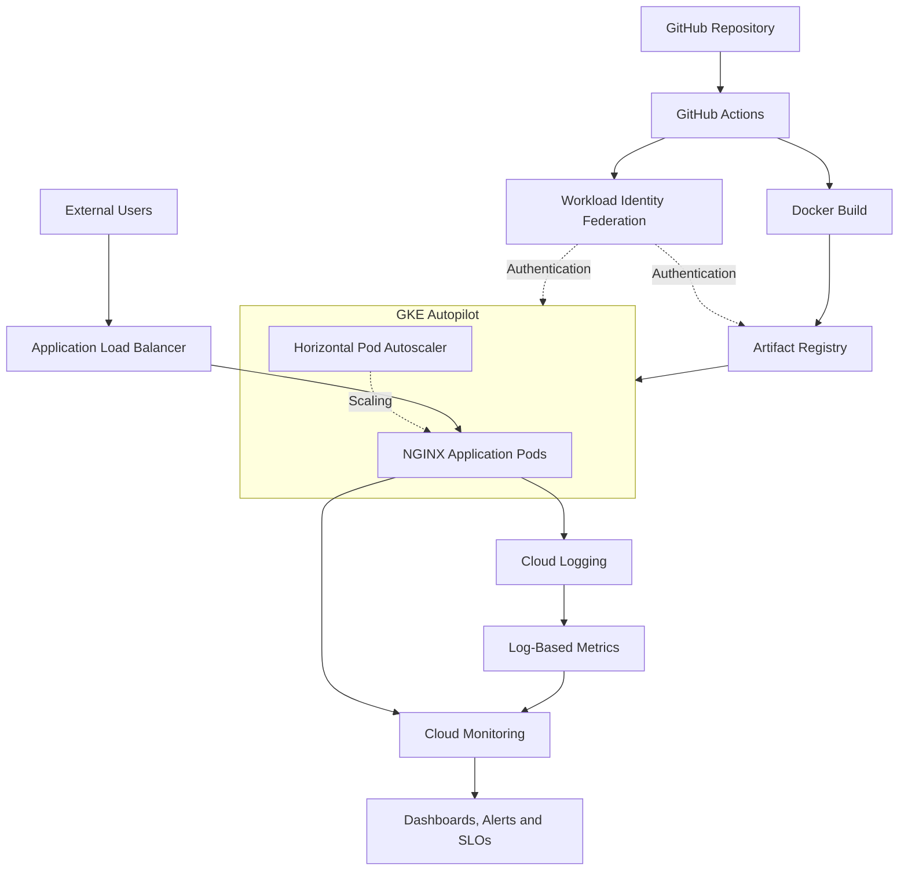

# System Architecture

## Architecture Overview

The project integrates automated CI/CD,
Kubernetes infrastructure, secure authentication,
and centralized observability on Google Cloud.

## Architecture Components

| Component | Purpose |
|---|---|
| GitHub Actions | Automated application delivery |
| Workload Identity Federation | Keyless authentication |
| Artifact Registry | Container image storage |
| GKE Autopilot | Kubernetes orchestration |
| Load Balancer | External application access |
| HPA | Automatic application scaling |
| Cloud Monitoring | Metrics, dashboards and alerts |
| Cloud Logging | Centralized application logs |
| Terraform | Infrastructure configuration |

## Reliability Features

- Rolling deployments
- Liveness and readiness probes
- CPU-based autoscaling
- Application availability monitoring
- Versioned container images
- Kubernetes rollback and recovery

## Infrastructure Note

Terraform configurations were developed and validated.
Infrastructure provisioning through Terraform remains
future work.
